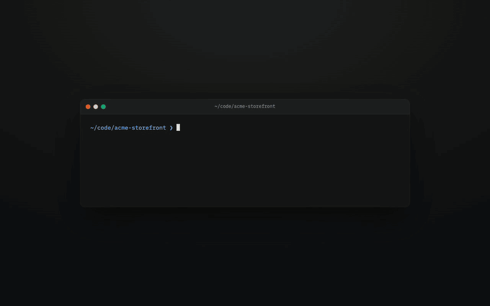
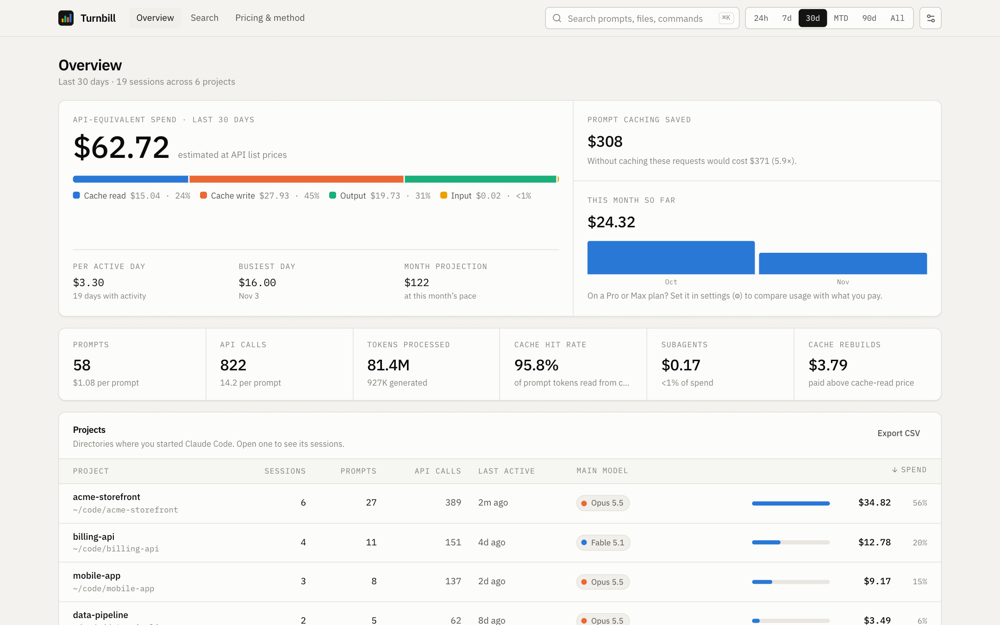
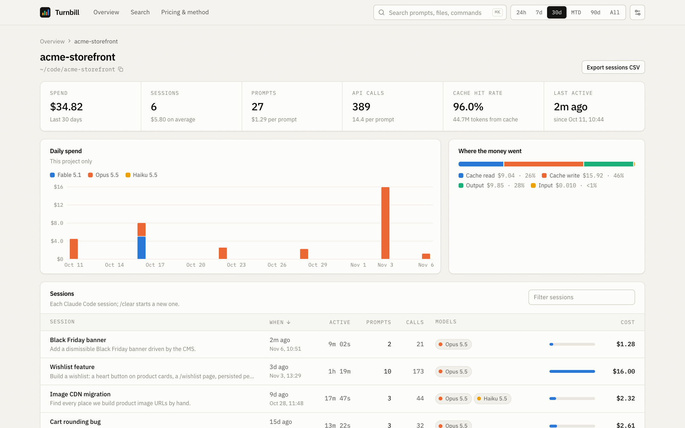
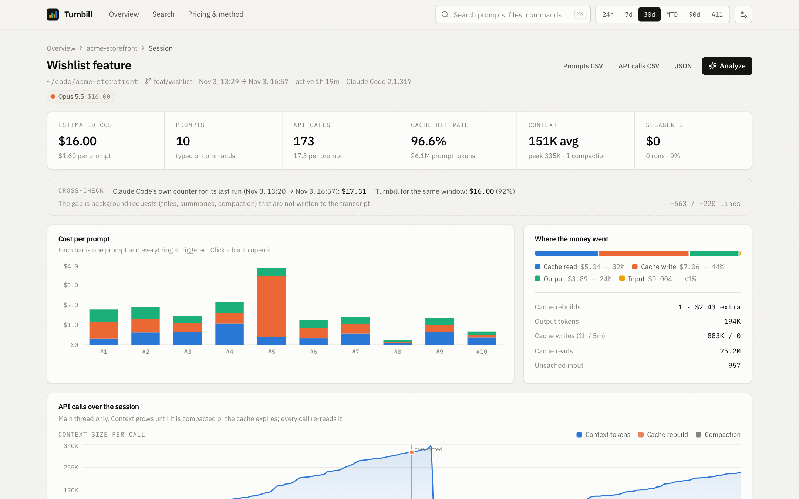
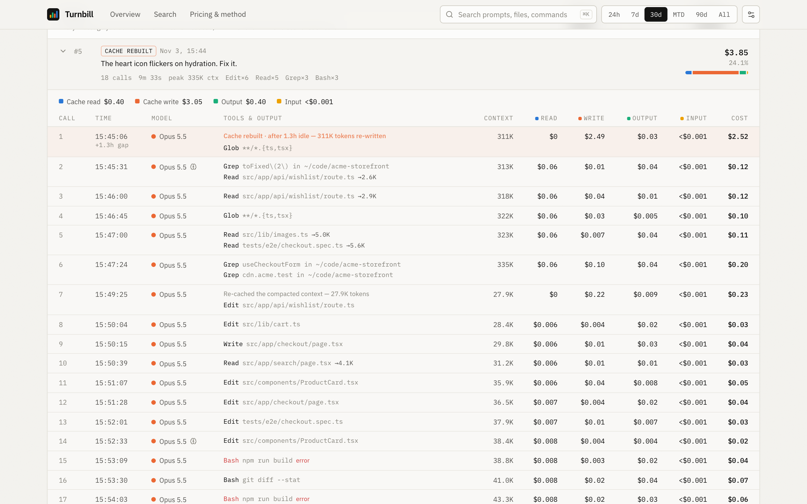
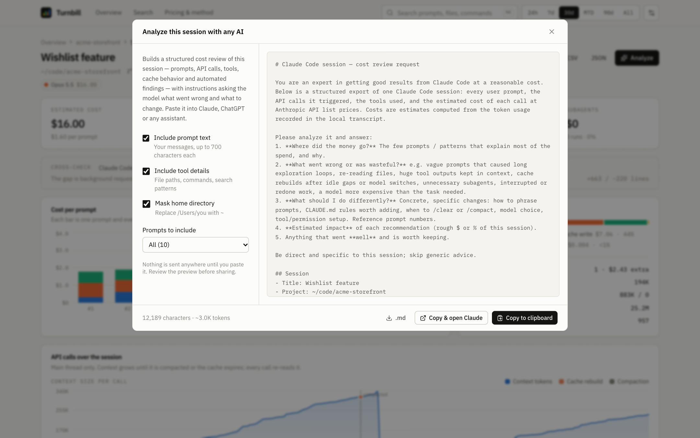

# Turnbill

[English](README.md) · [Türkçe](README.tr.md) · **Español**

Descubre cuánto te cuesta usar Claude Code, hasta el último prompt y la última llamada a la API. Turnbill lee las transcripciones que Claude Code ya guarda en tu equipo y les aplica los precios de lista de la API de Anthropic. También muestra por qué un prompt salió caro.

<p align="center">
  
</p>
<p align="center"><a href="docs/media/demo.mp4?raw=true">Ver el vídeo en alta calidad (MP4)</a> · La demo usa datos inventados.</p>

## Inicio rápido

```bash
npx turnbill
```

Después abre http://localhost:4317. Necesita Node.js 20 o posterior. No se sube nada: el servidor solo escucha en `127.0.0.1`.

| Opción | Valor por defecto | |
|---|---|---|
| `--port` | `4317` (o `$PORT`) | Puerto en el que escucha |
| `--dir` | `$CLAUDE_CONFIG_DIR/projects` o `~/.claude/projects` | Dónde guarda Claude Code las transcripciones |
| `--open` | desactivado | Abre el navegador |

## Qué incluye

**Resumen.** Gasto equivalente a la API en el periodo elegido, separado en lecturas de caché, escrituras de caché, salida y entrada. También muestra cuánto ahorró la caché de prompts, el gasto por día activo y la proyección a fin de mes. Después vienen:
- los proyectos ordenados por gasto
- un gráfico diario por modelo
- un mapa de calor día × hora
- las sesiones y los prompts más caros
- las sesiones que se están ejecutando ahora

Si indicas un plan Pro o Max, compara tu uso con lo que pagas.

<picture>
  <source media="(prefers-color-scheme: dark)" srcset="docs/media/overview-dark.png">
  
</picture>

**Proyecto.** Todas las sesiones iniciadas en un directorio, con tiempo activo, prompts, llamadas a la API, modelos y coste. Puedes filtrar la lista, ordenarla y exportarla a CSV.

<picture>
  <source media="(prefers-color-scheme: dark)" srcset="docs/media/project-dark.png">
  
</picture>

**Sesión.**
- **Coste por prompt.** Al hacer clic en una barra saltas a ese prompt.
- **Gráficos por llamada.** Muestran el tamaño del contexto y el coste de cada llamada, con las reconstrucciones de caché y las compactaciones marcadas.
- **Comprobación.** La estimación se compara con el contador de costes del propio Claude Code.
- **Observaciones y simulación.** También ves cuánto costarían los mismos tokens con otros modelos.

<picture>
  <source media="(prefers-color-scheme: dark)" srcset="docs/media/session-dark.png">
  
</picture>

**Prompt → llamadas a la API.** Al desplegar un prompt ves cada llamada a la API que provocó:
- las herramientas que ejecutó (archivos, comandos, patrones de búsqueda) y el tamaño de su salida
- el tamaño del contexto
- el coste por tipo de token

Las ejecuciones de subagentes aparecen anidadas. Cada reconstrucción de caché indica su causa, por ejemplo "after 1.3h idle — 311K tokens re-written".

<picture>
  <source media="(prefers-color-scheme: dark)" srcset="docs/media/prompt-dark.png">
  
</picture>

**Analyze.** Copia una revisión de costes estructurada de la sesión, con instrucciones, para que la pegues en Claude, ChatGPT o cualquier otro asistente y le preguntes qué salió mal y qué cambiar. Tú decides si incluir el texto de los prompts y los detalles de las herramientas, y si ocultar tu directorio personal. Antes de copiar ves una vista previa.

<picture>
  <source media="(prefers-color-scheme: dark)" srcset="docs/media/analyze-dark.png">
  
</picture>

**Observaciones.** Heurísticas que ponen precio a los despilfarros habituales:
- reconstrucciones de caché tras pausas o cambios de modelo
- contextos muy grandes
- salidas de herramientas grandes que se quedan en el contexto
- archivos leídos una y otra vez
- prompts atípicamente caros
- trabajo interrumpido
- peso de los subagentes
- fallos de herramientas
- uso de Fable donde bastaría Opus

Además: búsqueda en prompts, rutas de archivos y comandos (⌘K), exportación a CSV y JSON, tema claro y oscuro, y una página que documenta los precios y el método.

## Cómo se calculan los costes

- **Jerarquía.**
  - Un **proyecto** es el directorio en el que se inició Claude Code.
  - Una **sesión** es una transcripción. `/clear` empieza una nueva.
  - Un **prompt** es un mensaje que enviaste, un comando con barra o una notificación de tarea en segundo plano, junto con todo lo que desencadenó.
  - Una **llamada a la API** es una petición al modelo. Una llamada puede ejecutar varias herramientas.
- **Deduplicación.** Claude Code escribe cada respuesta en varias líneas de la transcripción. Las líneas se agrupan por el id del mensaje de la API y se conserva el uso final.
- **Precio por llamada.** La fórmula está abajo. Los multiplicadores de lectura de caché varían según el modelo. El modo rápido, el tramo por longitud de prompt de Haiku 5.5, el contexto largo de Sonnet 4/4.5 y la residencia de datos en EE. UU. se aplican cuando la transcripción los indica.

  ```
  entrada × precio de entrada
  + lecturas de caché × precio de lectura
  + escrituras de caché de 5 min/1 h × precio de escritura
  + salida × precio de salida
  + búsquedas web
  ```
- **Subagentes**: se leen de `<sesión>/subagents/*.jsonl`. Cada ejecución se asigna al prompt que estaba activo en ese momento.
- **Reintentos tras un rechazo.** Cuando un clasificador de seguridad rechaza una petición y Claude Code la reintenta con otro modelo, cada intento se calcula con el precio de su propio modelo. La facturación sigue [las reglas de Anthropic](https://platform.claude.com/docs/en/build-with-claude/refusals-and-fallback#how-refusals-are-billed).
- **Precios**: están en [`shared/pricing.ts`](shared/pricing.ts). Fuente: [precios de Anthropic](https://platform.claude.com/docs/en/about-claude/pricing), a 21-10-2026.

### Precisión

Algunas peticiones facturadas nunca llegan a la transcripción: los títulos de sesión, los resúmenes de ausencia, la compactación y las llamadas propias de las herramientas WebSearch/WebFetch. Por eso las estimaciones salen algo por debajo.

Claude Code también lleva su propio contador de costes para la última ejecución de cada sesión, y Turnbill compara su estimación con él. En el equipo del autor, en 65 sesiones, Turnbill llegó al **89 %** de ese contador. Puedes hacer la misma comprobación en tu equipo con `npm run calibrate`.

Si una ejecución termina sin guardar el contador (por ejemplo, al cerrar la terminal), esa ejecución desaparece del contador. Turnbill marca esas sesiones como "not comparable" (no comparables) en lugar de mostrar un porcentaje engañoso.

### Conservar más historial

Claude Code borra las transcripciones locales a los 30 días por defecto. Para ver un historial más largo, aumenta `cleanupPeriodDays` en `~/.claude/settings.json`:

```json
{ "cleanupPeriodDays": 365 }
```

## Privacidad

- El servidor se vincula a `127.0.0.1`. Rechaza las peticiones que no van dirigidas a localhost, lo que también bloquea el DNS rebinding.
- Las transcripciones solo se leen: nunca se modifican ni se suben.
- Las únicas peticiones de red son las de Google Fonts. Sin conexión, la interfaz usa las fuentes del sistema.
- Analyze solo copia texto al portapapeles.

## Desarrollo

```bash
npm install
npm run dev          # servidor de desarrollo de Vite con la API, http://localhost:5173
npm run demo         # compila, genera transcripciones inventadas en .demo/ y las sirve
npm test             # pruebas del parser, de precios y del store
npm run typecheck
npm run calibrate    # compara las estimaciones con el contador de Claude Code, sesión por sesión
```

```
server/   parser.ts (transcripción → sesiones/prompts/llamadas), store.ts (escaneo, caché, agregados),
          insights.ts, api.ts, index.ts (servidor de producción)
shared/   pricing.ts, types.ts (compartidos por servidor y cliente)
src/      aplicación React: pages/, components/, lib/
scripts/  demo-data.ts (transcripciones sintéticas), calibrate.ts
bin/      CLI turnbill
```

Las issues y los pull requests son bienvenidos. Cuando cambien los precios, actualiza `shared/pricing.ts` y la fecha `PRICING_AS_OF`.

## Aviso

Turnbill es un proyecto independiente. No está afiliado a Anthropic ni cuenta con su respaldo. Claude y Claude Code son marcas comerciales de Anthropic, PBC. Todos los costes son estimaciones basadas en los precios de lista públicos de la API. Tu factura, o lo que cubra un plan de suscripción, puede ser distinto.

## Licencia

[MIT](LICENSE)
