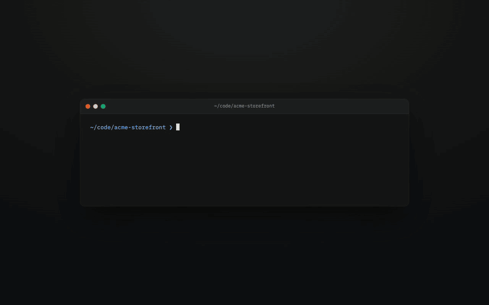
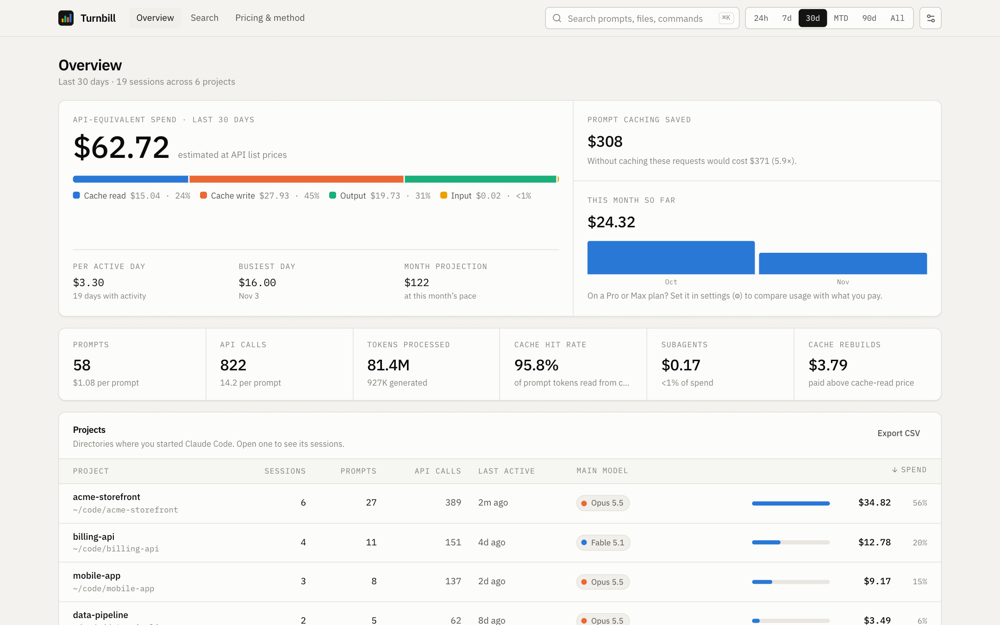
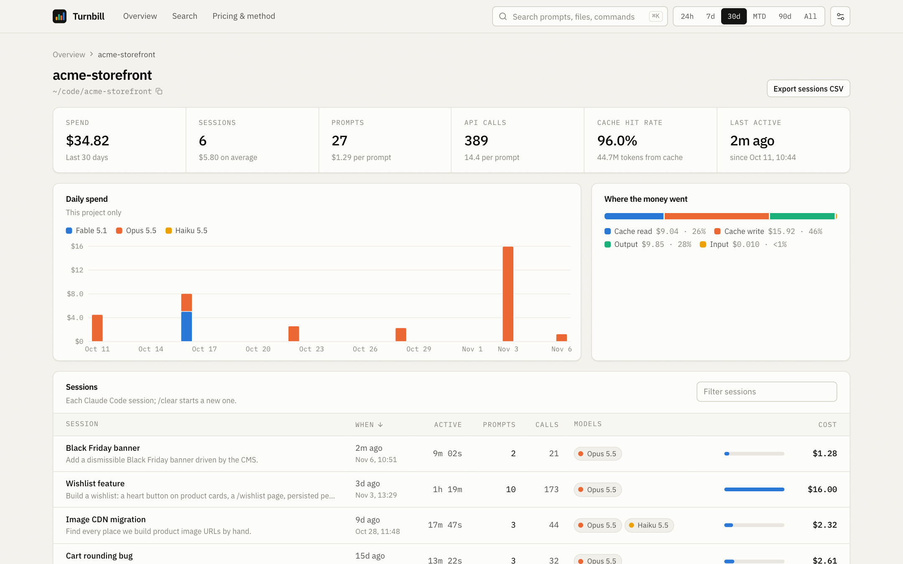
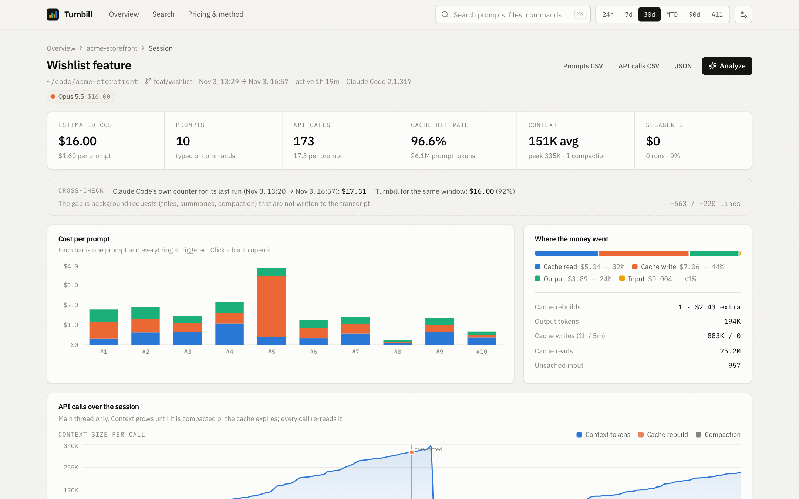
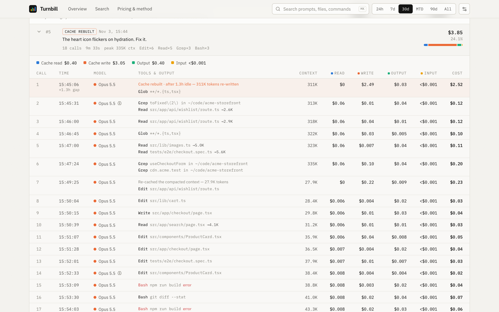
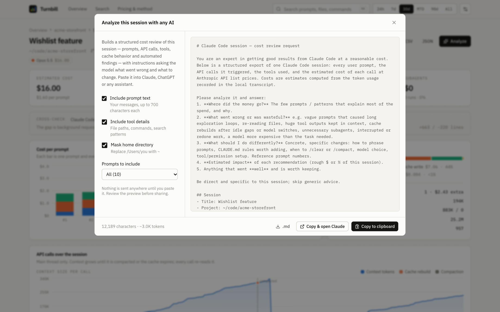

# Turnbill

[English](README.md) · **Türkçe** · [Español](README.es.md)

Claude Code kullanımının sana neye mal olduğunu her prompt'a ve her API çağrısına kadar gösterir. Turnbill, Claude Code'un zaten bilgisayarında tuttuğu transkriptleri okur ve Anthropic'in API liste fiyatlarıyla hesaplar. Bir prompt'un neden pahalıya patladığını da gösterir.

<p align="center">
  
</p>
<p align="center"><a href="docs/media/demo.mp4?raw=true">Yüksek kaliteli videoyu indir (MP4, 5 MB)</a> · Demoda uydurma veri kullanılır.</p>

## Hızlı başlangıç

```bash
npx turnbill
```

Sonra http://localhost:4317 adresini aç. Node.js 20 veya üstü gerekir. Hiçbir şey yüklenmez; sunucu yalnızca `127.0.0.1` üzerinde dinler.

| Bayrak | Varsayılan | |
|---|---|---|
| `--port` | `4317` (veya `$PORT`) | Dinlenecek port |
| `--dir` | `$CLAUDE_CONFIG_DIR/projects` veya `~/.claude/projects` | Claude Code transkriptlerinin bulunduğu yer |
| `--open` | kapalı | Tarayıcıyı aç |

## Neler var

**Genel bakış.** Seçilen aralıktaki API-eşdeğeri harcamayı cache okuma, cache yazma, output ve input olarak ayırır. Ayrıca prompt cache'in ne kadar tasarruf sağladığını, aktif gün başına harcamayı ve ay sonu tahminini gösterir. Ardından şunlar gelir:
- harcamaya göre sıralı projeler
- modele göre günlük grafik
- gün × saat ısı haritası
- en pahalı session'lar ve prompt'lar
- şu an çalışan session'lar

Ayarlardan Pro veya Max planını seçersen kullanımını ödediğin ücretle karşılaştırır.

<picture>
  <source media="(prefers-color-scheme: dark)" srcset="docs/media/overview-dark.png">
  
</picture>

**Proje.** Bir dizinde başlatılan tüm session'lar listelenir: aktif süre, prompt sayısı, API çağrıları, modeller ve maliyet. Liste filtrelenebilir, sıralanabilir ve CSV olarak indirilebilir.

<picture>
  <source media="(prefers-color-scheme: dark)" srcset="docs/media/project-dark.png">
  
</picture>

**Session.**
- **Prompt başına maliyet grafiği.** Bir çubuğa tıklayınca o prompt'a gidilir.
- **Çağrı grafikleri.** Her çağrının context boyutu ve maliyeti gösterilir; cache rebuild'ler ve compaction'lar işaretlidir.
- **Karşılaştırma.** Tahmin, Claude Code'un kendi maliyet sayacıyla karşılaştırılır.
- **Insight'lar ve what-if.** Aynı token'ların başka modellerde ne tutacağı da görülür.

<picture>
  <source media="(prefers-color-scheme: dark)" srcset="docs/media/session-dark.png">
  
</picture>

**Prompt → API çağrıları.** Bir prompt'u açınca yol açtığı her API çağrısını görürsün:
- çalışan tool'lar (dosyalar, komutlar, arama desenleri) ve çıktılarının boyutu
- context boyutu
- token türüne göre maliyet

Subagent çalıştırmaları ilgili prompt'un içinde görünür. Cache rebuild'ler sebebini de söyler; örneğin "after 1.3h idle — 311K tokens re-written".

<picture>
  <source media="(prefers-color-scheme: dark)" srcset="docs/media/prompt-dark.png">
  
</picture>

**Analyze.** Bir session'ın yapılandırılmış maliyet incelemesini talimatlarıyla birlikte kopyalar. Bunu Claude'a, ChatGPT'ye ya da başka bir asistana yapıştırıp neyin yanlış gittiğini ve neyin değişmesi gerektiğini sorabilirsin. Prompt metnini ve tool ayrıntılarını ekleyip eklememeyi, home dizinini gizleyip gizlememeyi sen seçersin; kopyalamadan önce önizlemeyi görürsün.

<picture>
  <source media="(prefers-color-scheme: dark)" srcset="docs/media/analyze-dark.png">
  
</picture>

**Insight'lar.** Yaygın israf türlerine dolar karşılığı biçen sezgisel kurallar:
- beklemelerden veya model değişiminden sonra cache rebuild
- çok büyük context
- context'te kalan büyük tool çıktıları
- tekrar tekrar okunan dosyalar
- sıra dışı pahalı prompt'lar
- yarıda kesilen işler
- subagent payı
- başarısız tool çağrıları
- Opus'un yeteceği yerde Fable kullanımı

Ayrıca: prompt, dosya yolu ve komutlarda arama (⌘K), CSV ve JSON dışa aktarma, açık ve koyu tema, fiyatlandırmayı ve yöntemi anlatan bir sayfa.

## Maliyet nasıl hesaplanıyor

- **Hiyerarşi.**
  - **Proje:** Claude Code'un başlatıldığı dizin.
  - **Session:** tek bir transkript. `/clear` yenisini başlatır.
  - **Prompt:** gönderdiğin bir mesaj, bir slash komutu veya bir arka plan görev bildirimi, ve tetiklediği her şey.
  - **API çağrısı:** tek bir model isteği. Bir çağrı birden fazla tool çalıştırabilir.
- **Tekilleştirme.** Claude Code tek bir yanıtı transkripte birkaç satır olarak yazar. Satırlar API mesaj kimliğine göre gruplanır ve son usage değeri tutulur.
- **Çağrı başına fiyat.** Formül aşağıda. Cache okuma çarpanları modele göre değişir. Fast mode, Haiku 5.5'in prompt uzunluğu kademesi, Sonnet 4/4.5 uzun context'i ve ABD veri yerleşimi, transkriptte görüldüğünde uygulanır.

  ```
  input × input fiyatı
  + cache okuma × cache okuma fiyatı
  + 5dk/1sa cache yazma × yazma fiyatı
  + output × output fiyatı
  + web aramaları
  ```
- **Subagent'lar** `<session>/subagents/*.jsonl` dosyalarından okunur. Her çalıştırma, o sırada aktif olan prompt'a bağlanır.
- **Red sonrası yedek model.** Bir güvenlik sınıflandırıcısı isteği reddedip Claude Code başka bir modelle yeniden denediğinde, her deneme kendi modelinin fiyatıyla hesaplanır. Faturalama [Anthropic'in kurallarına](https://platform.claude.com/docs/en/build-with-claude/refusals-and-fallback#how-refusals-are-billed) göre yapılır.
- **Fiyatlar** [`shared/pricing.ts`](shared/pricing.ts) dosyasında. Kaynak: [Anthropic fiyatlandırması](https://platform.claude.com/docs/en/about-claude/pricing), 2026-10-21 itibarıyla.

### Doğruluk

Bazı faturalanan istekler transkripte hiç yazılmaz: session başlıkları, uzaktayken özetleri, compaction ve WebSearch/WebFetch tool'larının kendi model çağrıları. Bu yüzden tahminler biraz düşük kalır.

Claude Code bir session'ın son çalıştırması için kendi maliyet sayacını da tutar ve Turnbill tahminini bununla karşılaştırır. Geliştiricinin makinesinde 65 session'da tahmin bu sayacın **%89**'u çıktı. Aynı kontrolü kendi makinende `npm run calibrate` ile yapabilirsin.

Sayacı kaydetmeden kapanan bir çalıştırma (örneğin terminal kapatıldığında) sayaçtan düşer. Turnbill bu session'ları yanıltıcı bir yüzde göstermek yerine "not comparable" (karşılaştırılamaz) olarak işaretler.

### Daha uzun geçmiş

Claude Code yerel transkriptleri varsayılan olarak 30 gün sonra siler. Daha uzun geçmiş görmek için `~/.claude/settings.json` içinde `cleanupPeriodDays` değerini artır:

```json
{ "cleanupPeriodDays": 365 }
```

## Gizlilik

- Sunucu `127.0.0.1` adresine bağlanır. Localhost'a gönderilmemiş istekleri reddeder; bu, DNS rebinding saldırılarını da engeller.
- Transkriptler yalnızca okunur; değiştirilmez ve hiçbir yere yüklenmez.
- Tek ağ isteği Google Fonts içindir. Bağlantı yoksa arayüz sistem fontlarını kullanır.
- Analyze yalnızca panoya metin kopyalar.

## Geliştirme

```bash
npm install
npm run dev          # API dahil Vite geliştirme sunucusu, http://localhost:5173
npm run demo         # build al, .demo/ içinde uydurma transkriptler üret ve göster
npm test             # parser, fiyatlandırma ve store testleri
npm run typecheck
npm run calibrate    # tahminleri Claude Code'un kendi sayacıyla session session karşılaştır
```

```
server/   parser.ts (transkript → session/prompt/çağrı), store.ts (tarama, önbellek, toplamlar),
          insights.ts, api.ts, index.ts (production sunucusu)
shared/   pricing.ts, types.ts (sunucu ve istemci ortak)
src/      React uygulaması: pages/, components/, lib/
scripts/  demo-data.ts (sentetik transkriptler), calibrate.ts
bin/      turnbill CLI
```

Issue ve pull request'ler memnuniyetle karşılanır. Fiyatlar değiştiğinde `shared/pricing.ts` dosyasını ve `PRICING_AS_OF` tarihini güncelle.

## Sorumluluk reddi

Turnbill bağımsız bir projedir; Anthropic ile bağlantılı değildir ve Anthropic tarafından onaylanmamıştır. Claude ve Claude Code, Anthropic, PBC'nin ticari markalarıdır. Tüm maliyetler herkese açık API liste fiyatlarına göre yapılmış tahminlerdir. Faturan veya abonelik planının kapsadığı tutar farklı olabilir.

## Lisans

[MIT](LICENSE)
